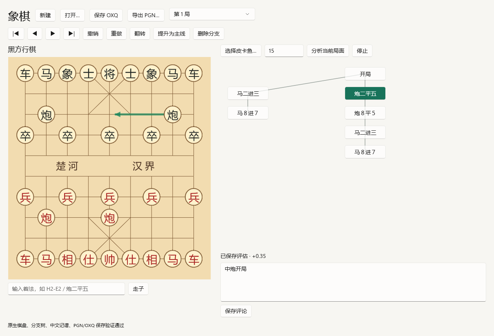

# Xiangqi Native

独立 Windows 原生象棋应用。采用 WinUI 3、C++20 和 OXQF；棋规、中文记谱与 PGN 直接复用原项目的纯计算代码，界面使用原生控件。

当前版本为迁移中的首个原型，完成棋局编辑到 OXQ 保存的主要链路。进度和未完成项见 [docs/PROGRESS.md](docs/PROGRESS.md)。



## 运行

已经构建的程序位于：

- build/winui/Release/XiangqiNative.exe
- 如需皮卡鱼，先运行 scripts/setup-engine.ps1 -Configuration Release；程序会自动发现同目录 engines 文件夹中的引擎。

运行时无需 Obsidian、Node.js 或浏览器。计算内核使用编译进程序的 QuickJS-NG；它不加载 UI，也没有文件系统或网络绑定。Windows App SDK 的原生运行库随输出目录一起部署，复制程序时需要保留整个输出目录。

棋盘支持点击选择棋子和落点，右侧分支图支持点击跳转。可输入 ICCS 或中文着法、编辑评论、撤销重做、提升主线、删除分支、保存 OXQ 和导出 PGN。PGN 多局文件会拆成可切换的棋局；每局独立保存为 OXQ。

## 从源码构建

需要 Windows 11 x64、Visual Studio C++ 桌面开发工具、Windows SDK 10.0.26100.0，以及网络连接用于首次 NuGet 还原。构建脚本自动初始化 MSVC 环境，并使用 Visual Studio 附带的 CMake 和 Ninja。

git clone 后先初始化子模块：

```powershell
git submodule update --init --recursive
./scripts/build.ps1 -Configuration Release
./scripts/setup-engine.ps1 -Configuration Release
./scripts/smoke.ps1 -Configuration Release
```

只构建 C++ 文档与引擎服务并运行测试：

```powershell
./scripts/build.ps1 -CoreOnly
```

计算内核的生成物已经提交，普通原生构建不需要安装 Node。修改计算代码后，使用 Node.js 24：

```powershell
npm ci --ignore-scripts
npm run kernel:build
npm run kernel:test
npm run upstream:test
./scripts/build.ps1
```

## 结构

| 目录                      | 职责                                     |
| ------------------------- | ---------------------------------------- |
| app                       | WinUI 原生窗口、棋盘、分支图与桌面对话框 |
| src/core、include/xiangqi | 文档、OXQF 适配、原子保存与 UCI 子进程   |
| kernel/upstream           | 原项目纯计算代码                         |
| kernel/bridge.ts          | 计算调用与模型映射                       |
| kernel/generated          | 可重复生成的 JS bundle 和嵌入字节数组    |
| external/oxqf             | 固定版本 OXQF 源码                       |
| external/quickjs          | 固定提交的 QuickJS-NG 子模块             |
| reference                 | 原始规则包、许可证和原项目回归测试       |

OXQF GameModel 是权威棋局数据。FEN、记谱与图形布局由计算内核生成并缓存；不存在一套独立可变的 UI 棋局树。

节点扩展信息通过带版本的 source_note 保存，见 [docs/ARCHITECTURE.md](docs/ARCHITECTURE.md)。这是本应用的兼容协议，不代表 OXQ v1 已定义标准的评估或箭头字段。

## 测试与许可证

测试包括原项目回归、计算内核对照、原生编辑和文件往返、真实进程 UCI 协议，以及实际 WinUI 初始化和渲染。冒烟测试会生成 result.json 与 native-preview.png。

本仓库以 GPL-3.0 发布。各依赖保留自身许可证，版本和来源见 [docs/DEPENDENCIES.md](docs/DEPENDENCIES.md)。
