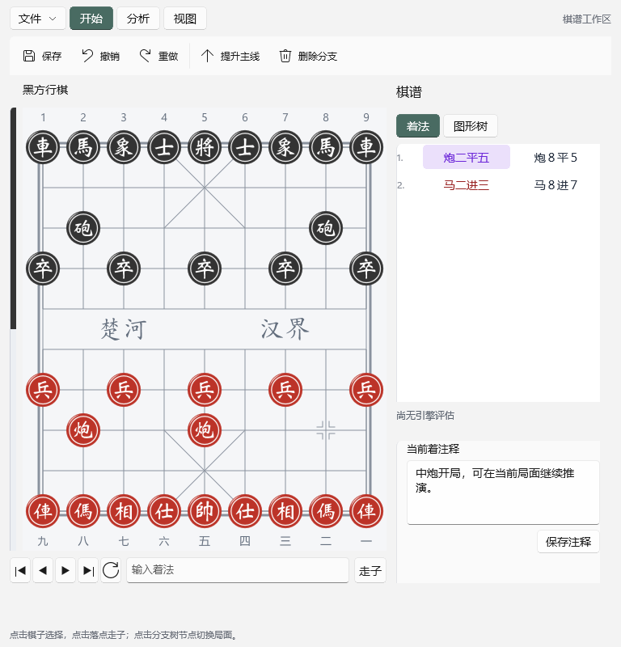

# Xiangqi Native

独立 Windows 原生象棋应用，使用 **WinUI 3、C++/WinRT、C++20 与 OXQF**。棋规、中文记谱、PGN 和分支布局已迁为 C++；源码构建与应用运行均无需 Node.js、JavaScript 运行时或 Obsidian。



目前为持续开发中的可运行版本，尚未覆盖原插件全部功能。实际进度见 [docs/PROGRESS.md](docs/PROGRESS.md)。

## 运行

Release 统一输出到 `build/winui/Release/`，可执行文件为 `build/winui/Release/XiangqiNative.exe`，后续版本不追加目录后缀。复制应用时保留 exe 所在的完整目录，Windows App SDK 运行库和素材随目录部署。当前验证平台为 Windows 11 x64。

- 纯色棋盘和 OXDF-editor 的矢量棋子资源；WinUI 原生按钮、菜单式选择器、文件对话框和文本框。
- 棋盘使用固定图层与局部更新，走子复用网格、按钮及 SVG 图像；点击棋子后会原地轻微放大，再点击落点走子；支持棋盘翻转、合法落点和 FEN 复制；河界文字与坐标统一为 SVG 路径，坐标位于棋子外侧；走子立即更新，没有起点残影或渐隐过渡。
- 紧凑分支树与双列中文着法，节点点击跳转、提升主线、删除分支、撤销/重做。
- 中文、WXF、ICCS 输入；PGN/OXQ 单局打开、评语与分析信息保留；单局 OXQ 保存及 PGN 导出。集合解析仍保留在核心层，界面暂不提供局数管理。
- 初版自适应布局：文件／开始／分析／视图命令分组，棋盘尺寸在启动时确定，窗口调整不再缩放；五个控制按钮与着法输入常驻同一行，注释常开。半屏切换着法与图形树，宽窗口同时展开。
- 原生皮卡鱼进程分析、停止分析、最佳着箭头、红方视角分数。棋盘左侧状态条通过颜色和上下位置提示当前行棋方，翻转棋盘时同步对调位置。

可选引擎安装：

```powershell
./scripts/setup-engine.ps1 -Configuration Release
```

程序自动发现 engines 目录，也可在界面选择已有引擎。操作与试用步骤见 [皮卡鱼使用指南](docs/PIKAFISH_GUIDE.md)。

## 构建与验证

需要 Visual Studio C++ 桌面工具、Windows SDK 10.0.26100.0、CMake 3.28+/Ninja、Git，以及首次获取依赖的网络连接。支持 VS 2022 v143 与当前开发机 VS v145；使用锁定的 Windows App SDK 和 C++/WinRT 包。无需安装 npm。

```powershell
./scripts/build.ps1 -Configuration Release
./scripts/smoke.ps1 -Configuration Release
./scripts/build.ps1 -Configuration Debug -CoreOnly
```

构建会运行 C++ 文档、引擎和旧实现对照测试。自测会启动实际 WinUI 应用，验证按钮走子、OXQ 保存往返、棋子选择、取消选择、走子及翻转渲染，输出位于 `build/winui/Release/smoke/`。


旧实现对照包含 600 个对局局面、23,063 个合法走法、8 个残局/重子局面、25 组 PGN 输入及 232 节点复杂分支布局。它们是迁移前保存的 JSON 数据，执行测试不需要旧 JS 实现。

## 源码

业务核心在 src/core，原生界面在 app，OXQF 由 FetchContent 从 https://github.com/pkuimyy/OXQF.git 获取，固定提交 206f807f8083ae0ec9384499a35313cb97c7a199；直接使用上游的 OXQF::format、OXQF::convert targets。依赖缓存在 build/native/_deps，WinUI 的头文件、静态库及许可路径由 CMake 自动生成。详见 [架构](docs/ARCHITECTURE.md)、[依赖与素材来源](docs/DEPENDENCIES.md)。

项目保留原应用 GPL-3.0 许可及第三方授权说明。原 Obsidian 项目和 OXQF 工作目录未被修改。
